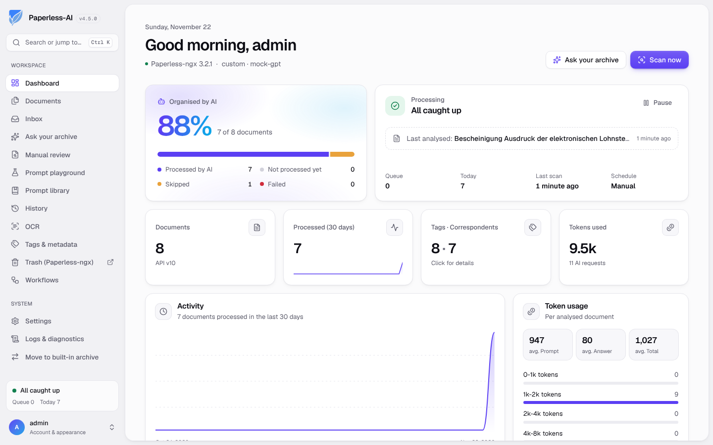
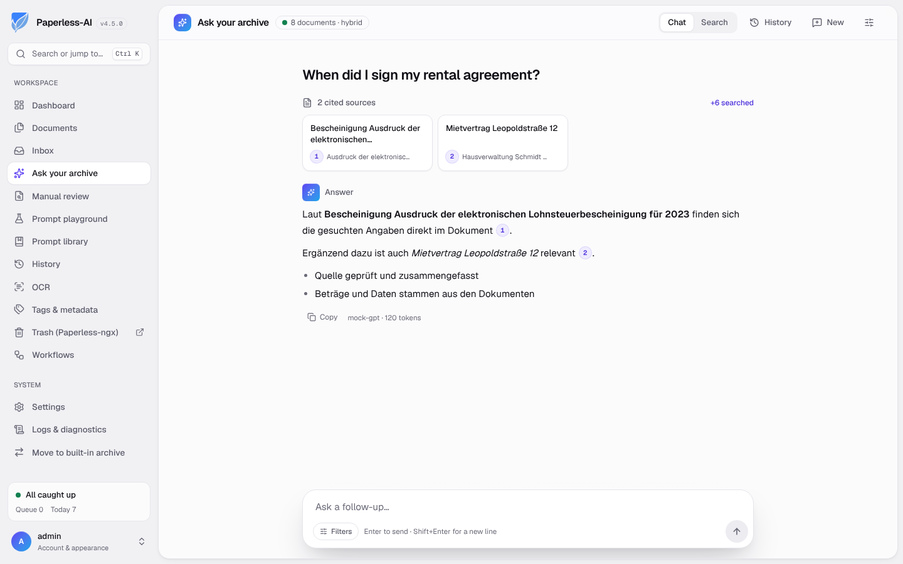
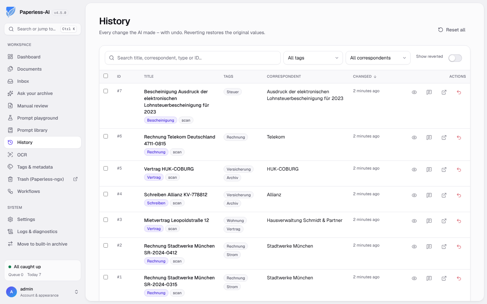
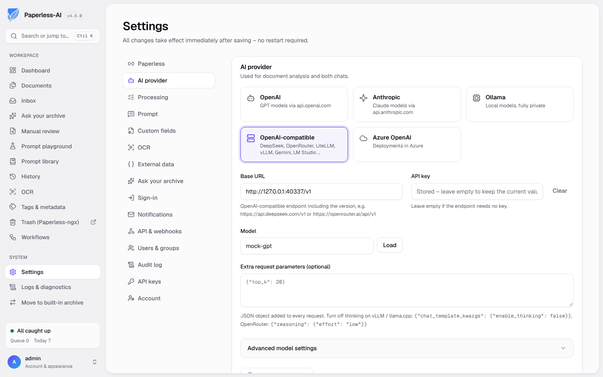

# 📄 Paperless-AI

[](https://github.com/clusterzx/paperless-ai/commits/main)
[](https://hub.docker.com/r/clusterzx/paperless-ai)
[](https://github.com/clusterzx)
[](LICENSE)

**Paperless-AI** is an AI extension for [Paperless-ngx](https://github.com/paperless-ngx/paperless-ngx). It analyzes your documents and fills in title, tags, correspondent, document type, date and custom fields – and lets you **ask questions about your whole archive** in natural language, with answers that cite their sources.

Works with **Paperless-ngx 2.x and 3.x**, OpenAI, Anthropic (Claude), **Ollama (fully local)**, Azure OpenAI and every OpenAI-compatible API (DeepSeek, OpenRouter, LiteLLM, vLLM, LM Studio, Gemini, Together, Perplexity, …).

> 💡 Just ask:
> “When did I sign my rental agreement?”
> “What was the amount of the last electricity bill?”
> “Which documents mention my health insurance?”



---

## 🚀 Features

**Automatic processing**
- Title, tags, correspondent, document type, date and **custom fields** for new documents – on a schedule or instantly via a Paperless **workflow webhook**
- **OpenAI**, **Anthropic (Claude)**, **Ollama**, **Azure OpenAI** and any **OpenAI-compatible** API – reasoning models included
- Process everything or only documents with **trigger tags**, skip documents with **exclude tags**; restrict the AI to existing tags, correspondents and document types
- Optional context from an **external API** (e.g. your customer list); parallel processing, retries, rate limits pause the queue instead of failing documents

**OCR** (optional) – reads scans and photos locally with PaddleOCR before the AI analysis, replaces the Paperless text only when it reads better (with undo), on the CPU or an NVIDIA GPU. → [OCR](#ocr)

**Ask your archive** – questions in plain language over all documents: hybrid keyword and vector search, streamed answers with cited sources, exact numbers from Paperless for “how many …?” questions, and a search mode without AI costs. → [Embeddings](#choosing-embeddings-for-ask-your-archive)

**Calendar** (optional) – appointments, due dates and deadlines found during the AI analysis, with a private iCal link for your calendar app. → [Calendar](#calendar)

**Tools** – document chat, manual review, prompt playground, prompt wizard and a prompt library with ratings per model, history with undo, dashboard, live logs and diagnostics; light/dark theme, ⌘K / Ctrl+K command menu, works on mobile.

**Sign-in** – two-factor authentication and [single sign-on](#single-sign-on-openid-connect) with any OpenID Connect provider (Authentik, Keycloak, Authelia …); API keys for webhooks and scripts.

| Ask your archive | Manual review |
| --- | --- |
|  |  |
| **History with undo** | **Settings** |
|  |  |

Release notes: [GitHub Releases](https://github.com/clusterzx/paperless-ai/releases).

## 🐳 Installation

```yaml
# docker-compose.yml
services:
  paperless-ai:
    image: clusterzx/paperless-ai:latest
    container_name: paperless-ai
    restart: unless-stopped
    ports:
      - "3000:3000"
    volumes:
      - paperless-ai_data:/app/data
    extra_hosts:
      - "host.docker.internal:host-gateway" # to reach Ollama on the Docker host

volumes:
  paperless-ai_data:
```

```bash
docker compose up -d
```

Open `http://<your-server>:3000` – the setup wizard guides you through account, Paperless connection, AI provider and processing options. No restart is needed afterwards.

**Image variants:**

| Tag | For |
| --- | --- |
| `latest` (= `latest-cpu`), `4.x.y` | default – amd64 and arm64, OCR and local embeddings on the CPU |
| `latest-cuda`, `4.x.y-cuda` | NVIDIA GPU for OCR (amd64, CUDA 13 + cuDNN 9). Needs the [NVIDIA Container Toolkit](https://docs.nvidia.com/datacenter/cloud-native/container-toolkit/latest/install-guide.html) and a driver ≥ 580; falls back to the CPU when no GPU is found |

```yaml
    image: clusterzx/paperless-ai:latest-cuda
    deploy:
      resources:
        reservations:
          devices:
            - driver: nvidia
              count: 1
              capabilities: [gpu]
```

**Paperless API user:** create a dedicated user in Paperless-ngx with permission to *view* and *change* documents, tags, correspondents, document types and custom fields, and use its API token (Profile → API Auth Token). Only documents this user may change are processed.

### Upgrading from 3.x

Keep your data volume and switch the image – everything else happens on the first start.

1. **Back up** the data volume (`docker volume ls` shows its exact name, often with the project name in front):
   ```bash
   docker compose stop paperless-ai
   docker run --rm -v paperless-ai_data:/data -v "$PWD":/backup alpine \
     tar czf /backup/paperless-ai-3x-backup.tgz -C /data .
   ```
2. **Update `docker-compose.yml`:** use `image: clusterzx/paperless-ai:latest` (or a fixed [version tag](https://hub.docker.com/r/clusterzx/paperless-ai/tags)), keep the volume `…:/app/data` and the port. Remove the 3.x lines `RAG_SERVICE_URL`, `PUID` and `PGID` (no longer used) and `RAG_SERVICE_ENABLED` (it would lock the setting in the UI).
3. **Start:** `docker compose pull && docker compose up -d`. The log (`docker compose logs -f paperless-ai`) shows `Migrated legacy data/.env configuration to data/config.json` and `Imported data from legacy documents.db` with the number of migrated users, documents and history entries.
4. **Sign in** with your previous username and password and review the settings – everything is prefilled; values set by environment variables are shown locked.

What is migrated: settings from `data/.env`, the user account, which documents were already processed (nothing is analysed again, no extra AI costs), the history including the original values (undo works for old changes too) and the token statistics. The search index for *Ask your archive* is rebuilt in the background; the first time, the built-in embedding model (~120 MB) is downloaded. The 3.x files (`.env`, `documents.db`) are left untouched, so you can switch back to the 3.x image – it just won't know about anything done in 4.0.

> [!WARNING]
> **If your 3.x instance was reachable from the internet** (without an additional login such as a VPN or an authenticating reverse proxy in front of it), it may have been taken over through the setup wizard – see the security notice above. 3.x only has one account, so the clearest sign is that **your previous username and password no longer work**, or that the settings contain a Paperless URL or AI endpoint you did not set. In that case:
> - do **not** migrate the old data – start 4.0 with a new, empty data volume and run the setup again;
> - create a **new Paperless API token** for Paperless-AI and delete the old one, and replace the **API keys** of your AI provider;
> - check the Paperless-ngx logs for document access with the old token.
>
> In any case, don't expose a fresh installation to the internet before the setup is completed: until the first account exists, the setup wizard is open to everyone who can reach it.

### Instant processing with a Paperless workflow

1. Paperless-ngx → *Workflows* → *Add workflow*, trigger **Document Added**
2. Action **Webhook**: URL `http://paperless-ai:3000/api/webhook/document`, body parameter `url` = `{doc_url}`
3. Header `x-api-key: <API key from Settings → API & webhooks>`

## ⚙️ Configuration

Everything can be configured in the web interface. Settings are stored in `data/config.json`.
Environment variables **override** stored settings (the UI shows them as locked) – handy for Docker deployments. The variable names of 3.x are still supported.

| Variable | Setting |
| --- | --- |
| `PAPERLESS_AI_PORT` | HTTP port (default `3000`) |
| `PAPERLESS_AI_DATA_DIR` | data directory (default `./data`, `/app/data` in Docker) |
| `PAPERLESS_AI_RESET_2FA` | username – switches off two-factor authentication of that account at the next start (phone lost and no recovery codes left); remove it afterwards |
| `PAPERLESS_API_URL` (or `PAPERLESS_URL`), `PAPERLESS_API_TOKEN` | Paperless-ngx URL (with or without `/api`) and token – `PAPERLESS_API_URL` wins when both are set |
| `PAPERLESS_PUBLIC_URL` | URL for links opened in the browser (optional) |
| `AI_PROVIDER` | `openai`, `anthropic`, `ollama`, `custom`, `azure` |
| `OPENAI_API_KEY`, `OPENAI_MODEL` | OpenAI |
| `ANTHROPIC_API_KEY`, `ANTHROPIC_MODEL`, `ANTHROPIC_BASE_URL` | Anthropic (Claude); the base URL only for a gateway/proxy |
| `OLLAMA_API_URL`, `OLLAMA_MODEL`, `OLLAMA_KEEP_ALIVE` | Ollama |
| `OLLAMA_NUM_CTX` (or `OLLAMA_CONTEXT_SIZE`), `OLLAMA_THINK`, `OLLAMA_UNLOAD_WHEN_IDLE` | Ollama context size (`0` = per document), thinking (`auto`, `off`, `on`, `low`, `medium`, `high`), unload when the queue is empty |
| `CUSTOM_BASE_URL`, `CUSTOM_API_KEY`, `CUSTOM_MODEL`, `CUSTOM_EXTRA_BODY` | OpenAI-compatible provider; extra request parameters as JSON |
| `AZURE_ENDPOINT`, `AZURE_API_KEY`, `AZURE_DEPLOYMENT_NAME`, `AZURE_API_VERSION` | Azure OpenAI |
| `TOKEN_LIMIT`, `RESPONSE_TOKENS`, `AI_TEMPERATURE`, `AI_TIMEOUT_SECONDS` | model limits |
| `SCAN_INTERVAL`, `DISABLE_AUTOMATIC_PROCESSING`, `PROCESSING_CONCURRENCY` | scheduling |
| `PROCESS_PREDEFINED_DOCUMENTS`, `TAGS`, `REMOVE_TRIGGER_TAGS` | only process tagged documents |
| `EXCLUDE_TAGS` | never process documents with one of these tags automatically (comma-separated) – also not when the Paperless workflow webhook sends them; manual review and the OCR page still work |
| `ADD_AI_PROCESSED_TAG`, `AI_PROCESSED_TAG_NAME` | mark processed documents |
| `USE_PROMPT_TAGS`, `PROMPT_TAGS`, `USE_EXISTING_DATA`, `SYSTEM_PROMPT` | prompt |
| `OVERWRITE_CORRESPONDENT`, `SHARE_CREATED_OBJECTS` | replace existing correspondents (default off); create tags/correspondents/types without owner (default on) |
| `ACTIVATE_TAGGING`, `ACTIVATE_CORRESPONDENTS`, `ACTIVATE_DOCUMENT_TYPE`, `ACTIVATE_TITLE`, `ACTIVATE_CUSTOM_FIELDS`, `ACTIVATE_DOCUMENT_DATE` | enabled functions |
| `RESTRICT_TO_EXISTING_TAGS`, `RESTRICT_TO_EXISTING_CORRESPONDENTS`, `RESTRICT_TO_EXISTING_DOCUMENT_TYPES` | restrictions |
| `CUSTOM_FIELDS` | custom fields (JSON, format of 3.x) |
| `EXTERNAL_API_ENABLED`, `EXTERNAL_API_URL`, `EXTERNAL_API_METHOD`, `EXTERNAL_API_HEADERS`, `EXTERNAL_API_BODY`, `EXTERNAL_API_TIMEOUT`, `EXTERNAL_API_TRANSFORM` | external data |
| `RAG_ENABLED` (or `RAG_SERVICE_ENABLED`), `RAG_EMBEDDING_PROVIDER`, `RAG_EMBEDDING_MODEL`, `RAG_QUERY_EXPANSION` | ask your archive |
| `ACTIVATE_CALENDAR` | find appointments, due dates and deadlines for the calendar (default off) |
| `OCR_ENABLED`, `OCR_MODE` (`manual`, `missing`, `poor`, `always`), `OCR_WRITE_BACK` | OCR on/off, when it runs automatically, replace the text in Paperless (default on) |
| `OCR_LANGUAGE` (`latin`, `en`, `multi`, `cyrillic`, `eslav`, `greek`, `arabic`, `devanagari`, `korean`, `thai`, `tamil`, `telugu`), `OCR_QUALITY` (`fast`, `balanced`, `accurate`) | OCR model |
| `OCR_DEVICE` (`auto`, `cpu`, `cuda`), `OCR_THREADS`, `OCR_MAX_PAGES` | OCR hardware and limits (`0` threads = automatic, `0` pages = all) |
| `OCR_RELEASE` (`auto`, `document`, `idle`) | When the OCR models are unloaded and their memory is freed: `auto` = on the GPU after each document (before the AI analysis), on the CPU after 10 idle minutes |
| `API_KEY`, `JWT_SECRET` | secrets (generated automatically when unset; use at least 32 random characters for `JWT_SECRET`) |
| `LOG_LEVEL`, `LOG_FORMAT=json` | operations |
| `TRUST_PROXY` | behind a reverse proxy: number of proxy hops (usually `1`) or the proxy addresses – needed for correct client IPs (login rate limit) and secure cookies; off by default |
| `PAPERLESS_AI_URL` | address of Paperless-AI as the browser opens it (e.g. `https://paperless-ai.example.com`) – used for the single sign-on redirect URI; default: the address of the request |
| `OIDC_ENABLED`, `OIDC_ISSUER`, `OIDC_CLIENT_ID`, `OIDC_CLIENT_SECRET` | [single sign-on](#single-sign-on-openid-connect) with an OpenID Connect provider (the secret stays empty for a public client) |
| `OIDC_ALLOWED_GROUPS`, `OIDC_GROUPS_CLAIM`, `OIDC_SCOPES` | only members of these groups may sign in (comma-separated, empty = everyone the provider lets through); claim with the groups (default `groups`); scopes (default `openid profile email`) |
| `OIDC_AUTO_CREATE`, `OIDC_USERNAME_CLAIM`, `OIDC_BUTTON_LABEL`, `OIDC_PROVIDER_LOGOUT` | create accounts on the first sign-in (default on), claim for their names (default `preferred_username`), label of the login button, sign out at the provider too (default on) |
| `PASSWORD_LOGIN` | `false` = sign in with single sign-on only (takes effect only while single sign-on is set up) |

Empty variables (e.g. `OPENAI_API_KEY=` left in a compose file) are ignored, so they never replace what you configured in the web interface.

### OCR

*Settings → OCR* turns OCR on. The modes:

- **No text or poor text** (recommended): before the AI analysis, documents without text or with garbled text (text-quality score below 50) are read with OCR.
- **Only documents without text**: for archives where Paperless' own OCR is fine.
- **Every document**: best text for every document, costs time per document.
- **Manual**: only from the *OCR* page or the API (`POST /api/ocr/run`). The documents are analyzed by the AI afterwards.

The OCR text replaces the text in Paperless only when its text-quality score is higher than that of the existing text – a clean text layer of a digital PDF or well-read print is never replaced by a weaker OCR result (e.g. of handwriting); the AI then analyses the existing text, too. On the *OCR* page you can compare both texts and save the OCR text anyway.

- **Speed:** on a 4-core CPU an A4 page takes about 1–2 s (*Balanced*); *Accurate* reads small print better but is slow without a GPU.
- **GPU memory:** on the GPU the OCR models are unloaded after each document (*Unload the OCR models: Automatic*), so a local model (Ollama, llama.cpp …) on the same GPU gets all of the memory back. Without such a model choose *After 10 idle minutes*.
- **Models** (~20 MB) are stored in `data/models/paddleocr` and downloaded once; behind a proxy or offline set `HF_ENDPOINT` to a Hugging Face mirror. ONNX Runtime telemetry is switched off.

### Calendar

*Settings → Processing → Appointments & deadlines* turns the calendar on. From then on the AI analysis also asks for dates the recipient has to act on or attend – appointments (with time), payment due dates, deadlines (cancellation, objection, application) and expiry or renewal dates. They appear on the *Calendar* page with a link to the document; dates you hide stay hidden when the document is analysed again.

- **Earlier documents:** *Search documents* asks only for the dates of documents processed before (last 3 or 12 months, 3 years or all) – one small AI request per document, titles and tags in Paperless stay untouched.
- **Subscribe:** *Subscribe* shows a private link (`…/api/calendar/feed/<secret>.ics`). Add it in Google Calendar (*Other calendars → From URL*), Apple Calendar (*File → New Calendar Subscription*) or Outlook (*Subscribe from web*). The calendar app must be able to reach Paperless-AI at that address; anyone with the link can read the dates, so a new link can be created at any time.

### Single sign-on (OpenID Connect)

*Settings → Sign-in* connects Paperless-AI to your identity provider (or use the `OIDC_*` variables above). Register Paperless-AI there as a web application (*confidential* client, authorization code flow):

- **Redirect URI:** `https://paperless-ai.example.com/api/auth/oidc/callback` – shown in the settings, together with the **post-logout redirect URI** `https://paperless-ai.example.com/login`
- **Issuer URL:** the address in front of `/.well-known/openid-configuration` – *Test provider* checks it
- **Behind a reverse proxy** set `PAPERLESS_AI_URL` (or *Public address* in the settings) to the address your browser uses, so the redirect URI has the right scheme and host

Who may sign in: everyone the provider lets through for this application, or – with *Allowed groups* – only members of these groups. All Paperless-AI accounts have the same rights (settings included), so restrict access at the provider or name the groups. New accounts are created on the first sign-in; with *Create accounts automatically* off, an existing user signs in with the password once and links the account in *Settings → Account*. Once your account is linked you can switch off the password login – on a fresh installation (`PASSWORD_LOGIN=false`) the first single sign-on creates the first account.

| Provider | Notes |
| --- | --- |
| Authentik | *Applications → Providers → OAuth2/OpenID Provider*, redirect URI *strict*; issuer `https://authentik.example.com/application/o/<slug>/`. Groups come with the `profile` scope; bind the application to a group or policy to limit access. |
| Keycloak | Client with *Client authentication* on and *Standard flow*; issuer `https://keycloak.example.com/realms/<realm>`. For groups add a *Group Membership* mapper (claim `groups`, *Full group path* off) to the client's dedicated scope. |
| Authelia | Client with `redirect_uris`, `require_pkce: true`, `pkce_challenge_method: S256`, `token_endpoint_auth_method: client_secret_basic` and the scopes `openid profile email groups`; set *Scopes* (`OIDC_SCOPES`) to `openid profile email groups`. Issuer `https://auth.example.com`. |
| Others | Zitadel, Pocket ID, Kanidm, Entra ID, Google … work the same way. Without a client secret the client is treated as a public client (PKCE only). |

Signing in with single sign-on skips the two-factor code of Paperless-AI – use the multi-factor authentication of your provider. Provider down and the password login switched off? Start with `PASSWORD_LOGIN=true` and sign in with an account that has a password.

### Local models (Ollama)

- **Context size:** Paperless-AI sends a fixed `num_ctx` (default 16,384 tokens). Ollama reloads the model whenever `num_ctx` changes, so a fixed size keeps it loaded between documents. Longer documents are shortened to fit; raise the size if your GPU has room, or set `0` to size it per document.
- **Thinking:** thinking models (qwen3, gpt-oss, deepseek-r1 …) can be switched off in *Settings → AI provider*, which is much faster for metadata extraction. gpt-oss also accepts `low`/`medium`/`high`.
- **Free the GPU:** *Unload the model when the queue is empty* releases the memory right after the last document; alternatively use *Keep model loaded* (`keep_alive`).
- **Other local servers** (vLLM, llama.cpp, LM Studio) run as *OpenAI-compatible* provider; parameters such as `{"chat_template_kwargs": {"enable_thinking": false}}` go into *Extra request parameters*.

### Self-signed certificates

If Paperless-ngx or your AI server uses a certificate from your own CA, mount the CA certificate and point Node.js to it:

```yaml
    environment:
      - NODE_EXTRA_CA_CERTS=/certs/my-ca.pem
    volumes:
      - ./my-ca.pem:/certs/my-ca.pem:ro
```

As a last resort, `NODE_TLS_REJECT_UNAUTHORIZED=0` turns certificate checks off completely. ⚠️ This applies to **every** connection of Paperless-AI – including the one carrying your OpenAI/Anthropic API key – so anybody in the network path could read and change the traffic. Only use it for testing in a trusted network.

### Choosing embeddings for “Ask your archive”

| Option | Notes |
| --- | --- |
| **Local** (default) | `Xenova/multilingual-e5-small` (~120 MB, downloaded once to `data/models`), 100+ languages incl. cross-lingual search, runs on the CPU in a worker thread (≈ 0.5 GB RAM while indexing, released after 5 minutes idle) |
| Ollama | e.g. `nomic-embed-text`, `bge-m3`, `mxbai-embed-large` (`ollama pull …`) |
| OpenAI / OpenAI-compatible / Azure | e.g. `text-embedding-3-small` |
| None | keyword search only (BM25) – smallest footprint |

Changing the embedding model re-embeds the passages automatically; the keyword search keeps working meanwhile.

Memory: the vector index keeps one byte per dimension and passage in RAM (a document has about one passage per 1,000 characters) – e.g. 100,000 passages need ≈ 40 MB with the local model (384 dimensions) and ≈ 155 MB with `text-embedding-3-small` (1,536 dimensions).

**Smart search terms** (on by default, `RAG_QUERY_EXPANSION=false` to disable): before searching, the AI adds a few search terms to the question – synonyms, names and translations into the language of your archive. This costs one short extra AI call per question and noticeably improves the hit rate, especially when you ask in a different language than your documents are written in.

Retrieval quality, measured with `npx tsx e2e/rag-eval/run.ts` (49 German/English documents, 27 questions in both languages; “hit@k” = the right document is among the first k sources the AI sees):

| Retrieval | hit@1 | hit@3 | hit@5 |
| --- | --- | --- | --- |
| Keyword only | 56 % | 70 % | 70 % |
| Hybrid, local model | 81 % | 89 % | 93 % |
| Hybrid, local model + smart search terms (`qwen2.5:3b` via Ollama) | 85 % | **100 %** | **100 %** |

## 🔌 API

The REST API is documented at `/api-docs` (OpenAPI). Authenticate with the header `x-api-key`. The endpoints used by the Paperless-AI browser extension and by scripts written for 3.x (`/chat/init/:id`, `/chat/message`, `/api/scan/now`, `/api/webhook/document`, `/api/rag/ask`, …) are still available.

## 🧑‍💻 Development

Requirements: Node.js ≥ 22.12.

```bash
npm install
npm run dev          # backend (tsx watch, port 3000) + web UI (Vite, port 5173)
npm run demo         # demo with a fake Paperless-ngx and a fake LLM: http://127.0.0.1:3456 (admin / demo1234)
npm run check        # typecheck + lint + unit/integration tests
npm run test:e2e     # Playwright end-to-end tests (uses the demo server)
# compatibility check against a real (disposable!) Paperless-ngx instance:
PAPERLESS_URL=http://localhost:8000 PAPERLESS_TOKEN=… npx tsx e2e/real-paperless-check.ts
npm run build && npm start
```

Architecture overview: [docs/ARCHITECTURE.md](docs/ARCHITECTURE.md).

## 🤝 Contributing

Pull requests are welcome! Please run `npm run check` before submitting.

## 🆘 Support & Community

- [Issues](https://github.com/clusterzx/paperless-ai/issues)
- [Discord](https://discord.gg/AvNekAfK38)

## 📄 License

MIT – see [LICENSE](LICENSE).

**AI-assisted development**
Paperless-AI is a hobby project, and large parts of the new v4 code are written with the help of AI coding tools. The code is covered by automated tests, but AI-assisted code can still contain bugs or security issues that are easy to miss. Please report security problems privately as described in [SECURITY.md](SECURITY.md).

**No warranty**
This software is provided "as is", without warranty of any kind (see [LICENSE](LICENSE)). Keep it in your local network and don't expose it to the internet without additional protection, such as a VPN or an authenticating reverse proxy.

## 🙏 Support Development

[](https://www.patreon.com/c/clusterzx)
[](https://www.paypal.com/paypalme/bech0r)
[](https://www.buymeacoffee.com/clusterzx)
[](https://ko-fi.com/clusterzx)
