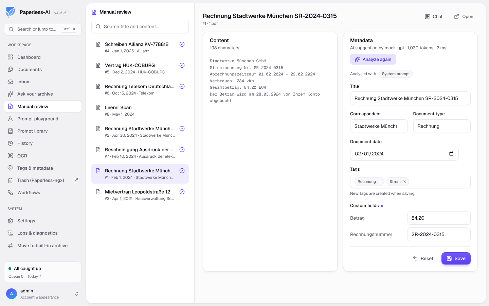

# 📄 Paperless-AI

[](https://github.com/clusterzx/paperless-ai/commits/main)
[](https://hub.docker.com/r/clusterzx/paperless-ai)
[](https://github.com/clusterzx)
[](LICENSE)

**Paperless-AI** analyzes your documents and fills in title, tags, correspondent, document type, date and custom fields – and lets you **ask questions about your whole archive** in natural language, with answers that cite their sources. It works as an extension of [Paperless-ngx](https://github.com/paperless-ngx/paperless-ngx) (2.x and 3.x) or **on its own** with the built-in archive.

AI providers: OpenAI, Anthropic (Claude), **Ollama (fully local)**, Azure OpenAI and every OpenAI-compatible API (DeepSeek, OpenRouter, LiteLLM, vLLM, LM Studio, Gemini, …).

> 💡 “When did I sign my rental agreement?” · “What was the amount of the last electricity bill?” · “Which documents mention my health insurance?”


## 🚀 Features

- **Automatic processing** – metadata for new documents on a schedule or instantly via a Paperless-ngx workflow; trigger and exclude tags; restrict the AI to existing tags, correspondents and types; [prompt rules](docs/guide/prompt-rules.md) per kind of document
- **[Ask your archive](docs/guide/ask-your-archive.md)** – questions in plain language, hybrid keyword and vector search, answers with sources
- **[OCR](docs/guide/ocr.md)** – reads scans and photos locally with PaddleOCR (CPU or NVIDIA GPU) before the analysis; optionally lays the text into the PDF (searchable PDF)
- **[Built-in archive](docs/guide/built-in-archive.md)** – run without Paperless-ngx: [upload, watch folders, e-mail, WebDAV, phone](docs/guide/intake.md); PDFs, images, text files, e-mails and – with LibreOffice built in, no extra service – [Office documents](docs/guide/built-in-archive.md#office-documents); versions, trash, libraries with roles; move over from Paperless-ngx with the same document ids; the [mobile apps made for Paperless-ngx](docs/guide/mobile-apps.md) work with it
- **[AI agents (MCP)](docs/guide/mcp.md)** – an MCP server for Claude, Hermes, OpenCode and other agents: search, read, ask, change and add documents, with fine-grained permissions, libraries and rate limits per API key
- **[Search and metadata](docs/guide/search-and-metadata.md)** – search syntax (`tag:steuer from:adac created:2024`), find and merge duplicate tags and correspondents
- **Workflows** – when something happens and the document matches, do something (tags, fields, e-mail, webhooks …), with test runs and undo
- **[Calendar](docs/guide/calendar.md)** – appointments and deadlines from your documents as an iCal subscription
- **Tools** – chat with every document, manual review, prompt playground and library, history with undo, live logs; two-factor authentication and [single sign-on](docs/guide/single-sign-on.md)

| Ask your archive | Manual review |
| --- | --- |
|  |  |

## 🐳 Quick start

```yaml
# docker-compose.yml
services:
  paperless-ai:
    image: clusterzx/paperless-ai:latest
    container_name: paperless-ai
    restart: unless-stopped
    ports:
      - "3000:3000"
    environment:
      - TZ=Europe/Berlin # your time zone: schedules, dates, logs
      # - TRUST_PROXY=1  # behind a reverse proxy (Traefik, Caddy, nginx, Coolify …)
    volumes:
      - paperless-ai_data:/app/data
      # Built-in archive: a folder for your scanner – set /scans as the watch folder in Settings → Archive
      - ./scans:/scans
    extra_hosts:
      - "host.docker.internal:host-gateway" # to reach Ollama on the Docker host

volumes:
  paperless-ai_data:
```

```bash
docker compose up -d
```

Open `http://<your-server>:3000` – the setup wizard asks for your account, the archive (Paperless-ngx or built-in), the AI provider and the processing options.

> [!IMPORTANT]
> Complete the setup before the instance is reachable from other networks, and keep Paperless-AI in your local network or behind a VPN or an authenticating reverse proxy.

More: [Installation](docs/guide/installation.md) (NVIDIA image, Paperless-ngx API user, instant processing, reverse proxy) · [Upgrading from 3.x](docs/guide/upgrading.md#upgrading-from-3x) · [Configuration](docs/guide/configuration.md)

## 📚 Documentation

All guides: **[docs/guide](docs/guide/README.md)** – installation, configuration, built-in archive, getting documents in, mobile apps, AI agents (MCP), search, prompt rules, OCR, Ask your archive, calendar, single sign-on, local models, certificates, API and development. Release notes: [GitHub Releases](https://github.com/clusterzx/paperless-ai/releases).

## 🆘 Support & Community

- [Issues](https://github.com/clusterzx/paperless-ai/issues)
- [Discord](https://discord.gg/AvNekAfK38)
- Contributing: pull requests are welcome – see [Development](docs/guide/development.md)

## 📄 License

MIT – see [LICENSE](LICENSE).

**AI-assisted development** – Paperless-AI is a hobby project, and large parts of the v4 code are written with the help of AI coding tools. The code is covered by automated tests, but AI-assisted code can still contain bugs or security issues that are easy to miss. Please report security problems privately as described in [SECURITY.md](SECURITY.md).

**No warranty** – this software is provided "as is", without warranty of any kind (see [LICENSE](LICENSE)). Don't expose it to the internet without additional protection, such as a VPN or an authenticating reverse proxy.

## 🙏 Support Development

[](https://www.patreon.com/c/clusterzx)
[](https://www.paypal.com/paypalme/bech0r)
[](https://www.buymeacoffee.com/clusterzx)
[](https://ko-fi.com/clusterzx)
